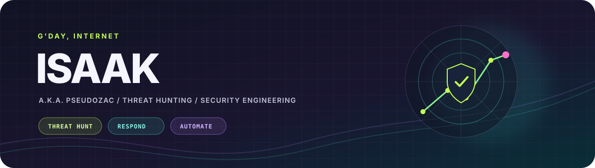

  

  <a href="https://www.linkedin.com/in/isaak99/">💼 LinkedIn</a>
  &nbsp;·&nbsp;
  <a href="https://www.instagram.com/i_z_a_a_c/">📸 Instagram</a>
  &nbsp;·&nbsp;
  <a href="https://github.com/pseudozac">💻 GitHub</a>

<h2 align="center">Turning noisy signals into clear stories.</h2>

  Hey, I'm Isaak — a cybersecurity professional working across SOC investigations, threat hunting, and network security.
  I like figuring out what happened, what the evidence actually says, and what to check next.

<table align="center">
  <tr>
    <td align="center"><strong>100+</strong> security alerts triaged monthly</td>
    <td align="center"><strong>&lt;30 min</strong> response-time SLA</td>
    <td align="center"><strong>58%</strong> less execution time through firewall automation</td>
  </tr>
</table>

## 🧪 Project notebook

  
Open the notebook — 4 prototypes in progress

   

  - **AI SOC Investigation Assistant** — IOC reputation checks for IPs, domains, and URLs to support first-pass L1 investigations.
  - **Incident Response & Threat Investigation Lab** — Synthetic endpoint and network events for evidence correlation, timelines, analyst notes, and MITRE ATT&CK mapping.
  - **Ethereum Blockchain Forensics & Wallet Tracing** — A Python prototype for read-only public-chain analysis, multi-hop tracing, and evidence-oriented reports with explainable risk indicators.
  - **Natter Chain** — A prototype exploring wallet-based sign-in, encrypted off-chain messaging, and message-integrity checks.

  These are prototypes; the project descriptions don’t imply live integrations or production deployment.

## 🧰 Toolkit

  
Peek at the tools I work with

   

  - **SIEM and endpoint:** Microsoft Sentinel, Securonix, Splunk Enterprise, Microsoft Defender XDR, CrowdStrike Falcon, Trend Micro
  - **Threat intelligence, cloud, and network:** Recorded Future, AWS GuardDuty, Vectra AI, Wireshark, Zscaler, Cloudflare, Akamai DDoS Protection
  - **Network security and automation:** Check Point, Fortinet, Skybox Security, BackBox Automation, Palo Alto Cortex XSOAR, Splunk SOAR

## 🎓 Background

  
Certifications and education

   

  **Certifications:** Zscaler Internet Access (ZIA) Certified Administrator · Zscaler Private Access (ZPA) Certified Administrator · Check Point Certified Security Administrator (R81)

  **Education:** B.E. in Computer Science and Engineering · Chandigarh University

## 🌙 Off shift

📸 Photography &nbsp; 🎮 Gaming &nbsp; ✈️ Travel &nbsp; 🎧 Anime, music, literature, and films
