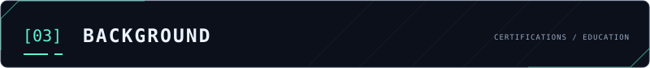
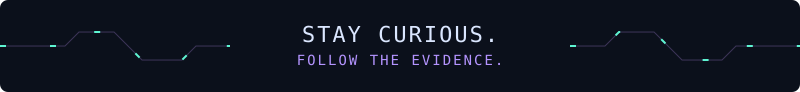

  

  
  &nbsp;
  
  &nbsp;
  

# Hey there, g'day! I'm Isaak a.k.a. [pseudozac](https://github.com/pseudozac) 👋

### Cybersecurity professional, writer, photographer, and gamer!

I follow the clues behind security alerts, then turn the evidence into a clear story: what happened, what it supports, and what to check next.

- 🛡️ **Into:** threat hunting, incident response, and security automation
- 🌙 **Off duty:** photography, gaming, travel, anime, music, literature, and films

##  Project notebook

  
<strong><code>projects /</code> Four prototypes in progress</strong> · expand the notebook

   

  - **AEGIS · AI SOC Investigation Assistant** — IOC reputation checks for IPs, domains, and URLs to support first-pass L1 investigations.
  - **Incident Response & Threat Investigation Lab** — Synthetic endpoint and network events for evidence correlation, timelines, analyst notes, and MITRE ATT&CK mapping.
  - **Ethereum Blockchain Forensics & Wallet Tracing** — A Python prototype for read-only public-chain analysis, multi-hop tracing, and evidence-oriented reports with explainable risk indicators.
  - **Natter Chain** — A prototype exploring wallet-based sign-in, encrypted off-chain messaging, and message-integrity checks.

  These are prototypes; the project descriptions don’t imply live integrations or production deployment.

##  My Favorite Tools

  
<strong><code>toolkit /</code> Tools and platforms from my security work</strong>

   

  ### `01` SOC & Threat Intelligence

  

    
    
    
    
    
  

  ### `02` Endpoint, Cloud & Network

  

    
    
    
    
    
    
    
    
  

  ### `03` Network Security & Automation

  

    
    
    
    
    
    
  

##  Background

  
<strong><code>background /</code> Certifications and education</strong> · expand the record

   

  **Certifications:** Zscaler Internet Access (ZIA) Certified Administrator · Zscaler Private Access (ZPA) Certified Administrator · Check Point Certified Security Administrator (R81)

  **Education:** B.E. in Computer Science and Engineering · Chandigarh University

  
   
  <samp>STAY CURIOUS. FOLLOW THE EVIDENCE.</samp>

